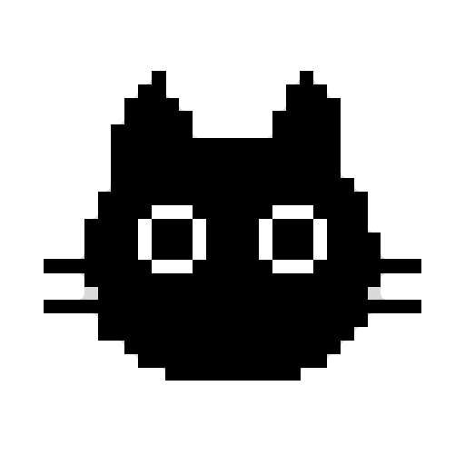

# 🐾 PixelPet

<p align="center">
  
</p>

<p align="center">
  <strong>Compagnon de bureau rétro en pixel art pour macOS, Windows et Linux</strong><br />
  Avec réactions physiques en temps réel, suivi global du regard, minuteur Pomodoro et monitoring pour agents IA.
</p>

<p align="center">
  <a href="https://github.com/martindufresne/PixelPet/releases"></a>
  
  
  
</p>

---

> [!WARNING]
> **Version en développement actif (v0.5.0-beta)**  
> Cette application est actuellement en version bêta de prévisualisation. Les fonctionnalités principales sont opérationnelles, mais certaines fonctionnalités avancées continuent d'être perfectionnées. Vos retours et contributions sont les bienvenus !

---

## ✨ Fonctionnalités

### 1. 🐱 Multi-espèces & Personnalisation
- **Chat (Comnyang)** : Rendu vectoriel SVG pixel-perfect fidèle à 100%, coloration dynamique par masque de pixels et 7 motifs officiels intégrés :
  - *Calico* (Tricolore), *Mackerel Tabby* (Tigré), *Siamese* (Siamois), *Cheese* (Roux), *Black* (Noir), *Russian Blue* (Bleu Russe), *White* (Blanc).
- **Chien (PixelDog)** : Architecture extensible avec modèle pixel art dédié et audio canin spécifique (*aboiement*, *aboiement d'alerte*, *halètement* — le chien ne miaule pas !).
- Changement d'animal et de pelage en un clic depuis le menu de la barre des tâches (System Tray).

### 2. 🎮 Interactions Physiques & Globales
- **👁️ Suivi fluide du regard (Eye Follow)** : Les pupilles s'orientent continuellement vers le curseur de votre souris sur l'ensemble de votre écran.
- **🐾 Pétrissage au clavier (Typing Knead)** : Dès que vous tapez au clavier dans n'importe quelle application, l'animal pianote des pattes (gauche / droite).
- **📜 Dérouleur de parchemin (Scroll Wheel)** : Faire défiler la molette de la souris fait dérouler un rouleau de papier toilette interactif.
- **🍡 Physique élastique Mochi (Zero-Wobble Drag)** : Déplacement fluide et direct de la fenêtre sans flottement ; tirer vers le haut étire le corps de l'animal avec un effet élastique mochi.
- **💖 Caresses & Ronronnement** : Passer délicatement la souris sur sa tête fait apparaître des cœurs et déclenche un ronronnement apaisant.
- **🔥 Mode Surchauffe (Overheat)** : À haute vitesse de frappe (> 6 touches/seconde), des volutes de vapeur s'échappent de sa tête.
- **🐭 Posture de chasse & Sieste** : L'animal se tapit lors de mouvements vifs et s'endort paisiblement après une période d'inactivité.

### 3. 🤖 Surveillance d'Agents IA (Agent Monitoring)
PixelPet réagit visuellement aux étapes de travail de vos agents d'intelligence artificielle :
- **💭 Réflexion (Thinking)** : Une bulle animée avec des points de suspension apparaît pendant que l'agent réfléchit ou génère du code.
- **🦘 Succès & Célébration (Task Done Jump)** : Dès que l'agent termine sa tâche, l'animal saute de joie et émet un son de victoire.
- **Agents supportés** :
  - **Google Antigravity** : Surveillance native des logs (`~/.gemini/antigravity-cli/log`) et hooks IPC.
  - **Claude Code** : Détection des sessions actives via journal de requêtes.
  - **Cursor & Codex** : Notifications en direct via le serveur HTTP local intégré.

### 4. 🧘 Santé au bureau & Productivité
- **⏱️ Minuteur Pomodoro** : Cycles de concentration (25 min) et de pause (5 min) gérés visuellement avec alertes sonores et animations dédiées.
- **💧 Rappels d'hydratation** : Notification visuelle invitant à boire de l'eau.
- **🤸 Pauses étirement** : Animations d'étirement pour soulager le dos et la posture.
- **📌 Pense-bête / Message fixe** : Affichez un mot doux ou un rappel permanent au-dessus de l'animal.

---

## 📥 Téléchargements (Releases)

Rendez-vous sur la page des [**Releases GitHub**](https://github.com/martindufresne/PixelPet/releases) pour télécharger la dernière version précompilée :

| Plateforme | Format | Description |
|---|---|---|
| **macOS (Apple Silicon M1/M2/M3/M4)** | `.dmg` | Installateur standard avec glisser-déposer vers Applications |
| **macOS (Apple Silicon M1/M2/M3/M4)** | `.zip` | Archive de l'application autonome `.app` |
| **Windows (x64)** | `.zip` | Version portable autonome (décompresser et exécuter `PixelPet.exe`) |

---

## ⚙️ Configuration macOS : Autorisations d'Accessibilité

Pour que PixelPet puisse animer ses pattes au clavier et dérouler son parchemin lors du défilement, macOS requiert l'autorisation d'Accessibilité :

1. Au premier démarrage, PixelPet affiche une invite : cliquez sur **« Ouvrir Réglages Système »**.
2. Dans **Réglages Système > Confidentialité et sécurité > Accessibilité**, activez l'interrupteur en face de **PixelPet**.
3. L'application détecte immédiatement l'activation et démarre les animations sans nécessiter de redémarrage.
4. *Astuce* : Vous pouvez également vérifier le statut d'accessibilité à tout moment depuis le menu dans la barre des tâches.

---

## 🚀 Démarrage en mode développement

### Prérequis
- [Node.js](https://nodejs.org/) v18+ (testé et validé sur Node.js v24)
- npm

### Installation
```bash
# Cloner le dépôt
git clone https://github.com/martindufresne/PixelPet.git
cd PixelPet

# Installer les dépendances
npm install

# Démarrer en mode développement
npm start
```

### Compiler les exécutables
```bash
# Pour macOS (.dmg et .zip ARM64)
npm run build:mac

# Pour Windows (.zip x64 portable)
npm run build:win

# Pour Linux (.AppImage, .deb)
npm run build:linux
```

---

## 🔌 Intégration HTTP pour Agents IA

PixelPet expose un serveur HTTP local léger sur le port `23456` pour recevoir les notifications d'état de vos scripts ou agents :

```bash
# Signaler que l'agent réfléchit
curl -X POST http://127.0.0.1:23456/agent-state \
  -H "Content-Type: application/json" \
  -d '{"agent": "antigravity", "state": "thinking"}'

# Signaler que l'agent a terminé sa tâche (déclenche le saut de joie)
curl -X POST http://127.0.0.1:23456/agent-state \
  -H "Content-Type: application/json" \
  -d '{"agent": "antigravity", "state": "complete"}'

# Revenir au repos
curl -X POST http://127.0.0.1:23456/agent-state \
  -H "Content-Type: application/json" \
  -d '{"agent": "antigravity", "state": "idle"}'
```

Un script d'aide en ligne de commande est également fourni :
```bash
node src/hooks/notify-agent.js --agent antigravity --state thinking
node src/hooks/notify-agent.js --agent antigravity --state complete
```

---

## 🐶 Architecture Multi-espèces

PixelPet a été conçu avec une architecture modulaire pour ajouter facilement de nouveaux animaux (`src/species/`) :
- Chaque espèce dispose de son propre répertoire avec un contrat d'interface (`index.js`).
- Définition des sons propres (`sounds/`), des gabarits SVG (`sprites/`), des presets de couleurs (`presets/`) et du vocabulaire (`vocab`).
- Pour ajouter une espèce, créez un module dans `src/species/<nom>/` et enregistrez-le dans `src/species/registry.js`. Il apparaîtra instantanément dans le menu système !

---

## 📄 Licence

Ce projet est sous licence [MIT](LICENSE).
Inspiré par le projet original [Comnyang](https://www.comnyang.com/en).
